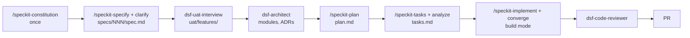

# dsf-speckit workflow

This factory uses [GitHub Spec Kit](https://github.com/github/spec-kit): the most formal spec-first flow of the five. Every feature goes through constitution, specify, clarify, plan, tasks, analyze and implement, each step producing a reviewed file in `specs/NNN-feature/`.

## How a feature flows



1. `make design`. Once per app, `/speckit-constitution`; the factory's starting constitution is already in place.
2. `/speckit-specify <feature>` (on a new branch `feature/NNN-name`) creates `specs/NNN-feature/spec.md`; `/speckit-clarify` asks about the gaps.
3. `dsf-uat-interview` turns the spec's acceptance scenarios into Gherkin in `uat/features/`.
4. `dsf-architect` keeps the module map and ADRs current; `/speckit-plan` writes the feature's technical plan within them.
5. `/speckit-tasks` and `/speckit-analyze` produce and cross-check `tasks.md`.
6. `make build`, then `/speckit-implement` and `/speckit-converge` until converged; `make check` and `make uat` are green.

Full step-to-skill mapping: [.dsf/CLAUDE.workflow.md](../../.dsf/CLAUDE.workflow.md).

## Strengths and weaknesses

| Strengths | Weaknesses |
| --- | --- |
| The most traceable flow: spec, plan, tasks and checks per feature, all in git. | The heaviest process; slow for small changes (use the bugfix workflow for those). |
| `/speckit-analyze` catches gaps between spec, plan and tasks before code exists. | Installed as files, so upgrades are a `specify` run plus a PR rather than a plugin update. |
| Agent-neutral: the same specs work with other coding agents. | Spec Kit's plan step can drift from the module map unless held to it. |

## Installing and upgrading

Nothing to install in an application: the skills are files in this repo. To upgrade, in the parent dsf-speckit repo (factory mode):

```bash
uv tool install specify-cli --force    # or: uv tool upgrade specify-cli
specify init --here --integration claude --script sh --force
git diff -- .specify .claude/skills    # keep .specify/memory/constitution.md as it is
```

Then run the factory benchmark ([docs/dsf/factory-evolution.md](../dsf/factory-evolution.md#benchmark)) and open a PR. Applications pick it up with `make sync-pull`.
